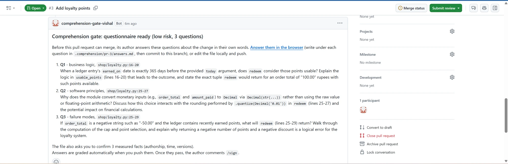
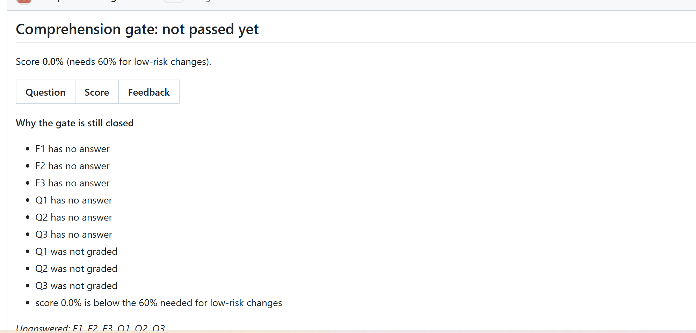
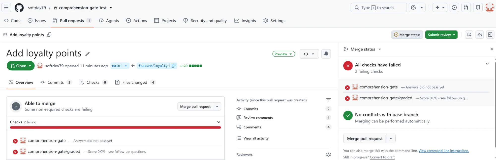

# comprehension-gate

Blocks a pull request from merging until its author has answered, passed and signed a
questionnaire about the code. It exists to stop comprehension debt: AI-written code shipped
by people who cannot explain it.

## How it works

1. **While coding** - a Claude Code plugin records which lines Claude wrote and when, in
   `.comprehension/ledger.jsonl` (paths, line counts and timestamps only).
2. **Pull request opened** - the *generate* workflow measures the change (authorship split,
   time taken, dependency versions, risk tier), asks the model for code-specific questions, and
   commits `.comprehension/pr-<n>/answers.md` to the branch. The `comprehension-gate` status
   is set to pending.
3. **Owner answers** - they fill in `answers.md` and push. The *grade* workflow has the model
   score each answer against the diff, then a deterministic policy decides pass or fail and
   posts follow-up questions for weak answers.
4. **Owner signs** - the author comments `/sign`. The *attest* workflow creates a
   Sigstore-signed attestation and sets `comprehension-gate` to success.

Make `comprehension-gate` a required status check in branch protection and the merge button
stays disabled until step 4.

## See it in action

From a live run of the GitHub App deployment on a test repository: a pull request that adds
loyalty points to a small shop module.

**1. The agent reads the change and posts code-specific questions.** It found the boundary
case where points earned exactly 365 days ago expire, and that a negative order total is not
rejected. The link opens `answers.md` in GitHub's editor on the PR branch.



**2. Answers are graded when they are pushed.** Here the file was committed with no answers,
so the deterministic policy fails it without spending a model call and lists what is missing.



**3. The PR shows the gate's commit statuses.** `comprehension-gate/graded` carries the score
and `comprehension-gate` stays failing until the author passes and signs. Make
`comprehension-gate` a required check and the merge button stays disabled.



## Layout

| Path | What it is |
|---|---|
| `.claude-plugin/`, `hooks/`, `commands/` | The Claude Code plugin (authorship and time capture) |
| `gate/evidence.py` | Measured facts: diff, authorship, time, versions |
| `gate/agents.py` | The two agents: question writer and answer grader |
| `gate/llm.py` | Model providers (Bedrock/OpenAI-compatible, Claude) and JSON validation |
| `gate/agent_loop.py`, `gate/tools.py` | Bounded tool-calling loop and its read-only repo tools |
| `scripts/smoke_bedrock.py` | Checks what the configured endpoint supports |
| `gate/policy.py` | Risk tiers and the pass/fail rules |
| `gate/questionnaire.py` | Questionnaire assembly and the `answers.md` format |
| `gate/cli.py` | Commands the workflows run |
| `workflow-templates/` | The three GitHub Actions workflows |
| `service/`, `deploy/` | The same gate as a GitHub App on AWS Lambda (see `deploy/README.md`) |
| `tests/` | Unit tests plus an offline end-to-end test |

## Set up on a repository

There are two ways to run the gate. **As a GitHub App on AWS** (recommended: the gate's code
and state live outside the pull request): follow [deploy/README.md](deploy/README.md).
**As GitHub Actions workflows**, the steps below:

1. The workflow templates check out the gate from `softdev79/comprehension-gate`. If you use
   a fork, change that `repository:` line in the three templates.
2. Copy `workflow-templates/*.yml` into `.github/workflows/` of the repository to gate.
3. Add repository secrets `OPENAI_API_KEY` and `OPENAI_PROJECT_ID`, and repository variables
   `OPENAI_BASE_URL` and `MODEL_ID` (default `openai.gpt-oss-120b`), for Amazon Bedrock's
   OpenAI-compatible endpoint. Run `python scripts/smoke_bedrock.py` locally first to check them.
4. In branch protection for the default branch, require the `comprehension-gate` status.
5. Developers install the plugin in Claude Code so authorship is recorded:
   `/plugin marketplace add softdev79/comprehension-gate` then `/plugin install comprehension-gate`.
   (Add a `.claude-plugin/marketplace.json` first; the hook command uses `python`, change it
   to `python3` where needed.)

## Try it locally, without an API key

```bash
python -m unittest discover -s tests
```

```bash
python comprehension_gate.py --repo path/to/repo evidence --base origin/main
```

```bash
python comprehension_gate.py --repo path/to/repo generate --pr 1 --base origin/main --offline
```

`--offline` writes template questions so you can see the file format; real questions need
the API.

## Configuration

Optional `comprehension-gate.json` in the gated repository's root overrides the defaults in
`gate/policy.py`:

```json
{
  "questions": { "low": 3, "medium": 6, "high": 10 },
  "pass_percent": { "low": 60, "medium": 70, "high": 80 },
  "high_risk_paths": ["*auth*", "*payment*"]
}
```

The model endpoint is set by environment variables (locally from `.env`, see `.env.example`):
`GATE_PROVIDER` (`openai` for Bedrock or another OpenAI-compatible API, or `anthropic`),
`OPENAI_BASE_URL`, `OPENAI_API_KEY`, `OPENAI_PROJECT_ID`, `MODEL_ID`, `GATE_JSON_MODE` and
`GATE_REASONING_EFFORT`. With `GATE_PROVIDER=anthropic`, set `ANTHROPIC_API_KEY` and optionally
`COMPREHENSION_GATE_MODEL` (default `claude-opus-5-5`). Replies are validated against their JSON
schema in code whichever provider is used.

On the `openai` provider the agents are agentic: before writing questions or grades they can
read files at the base or head commit, grep, list files, find tests and read a file's git log
(`gate/tools.py`, all read-only). Every question must point at a changed file and every
question must be graded exactly once, or the answer goes back to the model to fix.
`GATE_AGENT_MAX_TURNS` (default 12) caps the loop; `GATE_AGENTIC=0` falls back to one call.

## Known limits of this version

- **The gate's own files live in the pull request.** A same-repo author can edit the
  workflows, `comprehension-gate.json` or the ledger in their branch. Before relying on the
  gate, enforce the workflows from outside the branch: an organization ruleset with
  "Require workflows to pass", or CODEOWNERS on `.github/` and `comprehension-gate.json`.
  The questionnaire itself is already protected by a published hash.
- **Authorship is an estimate.** It covers Claude Code sessions with the plugin installed.
  Other tools are invisible, and with no ledger the split is reported as unknown.
- **Answers can be AI-written too.** Code-specific questions and strict grading raise the
  cost; they do not make it impossible.
- **Fork pull requests are skipped**, and a new code push regenerates the whole
  questionnaire instead of asking only about the new lines.
- **Sign-off is the PR author only.** No CODEOWNERS countersignature yet.
- **The workflows have not been run on GitHub yet.** The Python is tested; the YAML is not.
